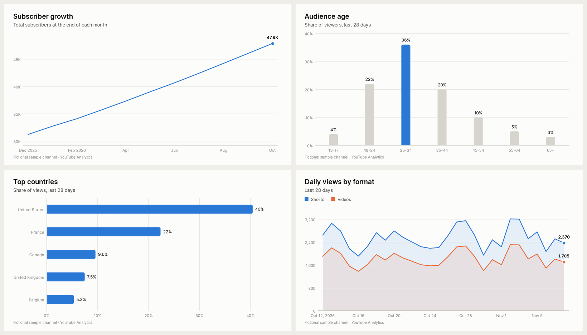

# YouTube Studio MCP

[](https://github.com/nelsonrogers/youtube-studio-mcp/actions/workflows/ci.yml)
[](LICENSE)


**Give your AI assistant your YouTube Studio data.** A local [Model Context Protocol](https://modelcontextprotocol.io)
server for creators: your agent (Claude, Cursor, VS Code, …) can read your channel analytics, dig
into your audience and content, build **media-kit data**, and render **ready-to-use charts**,
straight from the official YouTube APIs.

> "How did my channel do this month compared to last month, and why?"
> "Which Shorts brought me the most subscribers this quarter?"
> "What are people searching for when they find my videos?"
> "Where do viewers drop off in my latest video?"
> "Update my media kit with the last 28 days and make the charts."

It runs on your computer and signs in with your own Google OAuth client. Your data goes from
Google to your machine to your AI app, and nowhere else. It's read-only unless you opt in.

---

## What it can do

| Area | Tools |
|---|---|
| **Overview** | `get_performance_summary`: views, engaged views, watch time, avg view duration/%, subscribers gained/lost/net, likes, comments, shares, engagement rate, optional revenue, each vs the previous period |
| **Trends** | `get_metrics_over_time`: any metrics by day/week/month/year, Shorts/videos/live filter, running subscriber total for growth charts |
| **Content** | `list_videos`, `get_videos_details`, `get_top_videos` (ranked within a period, with YouTube's Shorts/Videos/Live classification), `list_playlists` |
| **Audience** | `get_audience_breakdown`: age, gender, age×gender, countries, US states, devices, OS, subscribers vs not, Shorts vs long-form, playback locations, sharing services |
| **Discovery** | `get_traffic_sources`: search, suggested, browse, Shorts feed, external…, plus the **search terms**, referring videos and websites |
| **Retention** | `get_audience_retention`: the retention curve with timestamps, key milestones and the steepest drop-offs |
| **Comments** | `list_comments`: recent comments channel-wide or per video, including the held-for-review queue |
| **Money** | `get_revenue`: estimated revenue, RPM, CPM, monetized playbacks, top-earning videos (YPP channels) |
| **Impressions & CTR** *(beta)* | `enable_impressions_reports`, `get_impressions`: thumbnail impressions and click-through rate, by day or video |
| **Media kit** | `get_media_kit_data`: one call returns a stable, documented JSON snapshot ([schema](docs/media-kit-data.md)) |
| **Charts** | `create_chart`: clean PNG/SVG/PDF charts (line, area, bar, horizontal bar, stacked, donut) with a colour-blind-safe palette, brand colours, dark mode, transparent backgrounds |
| **Anything else** | `query_analytics`: raw YouTube Analytics API v2 queries |
| **Editing** *(opt-in)* | `update_video_details` (with dry-run diff), `reply_to_comment`, `moderate_comments` |

Plus four prompt templates (`channel_checkup`, `media_kit_refresh`, `video_deep_dive`,
`comment_digest`). The full parameter reference is in [docs/tools.md](docs/tools.md).

<p align="center"></p>

## Quick start

You need [uv](https://docs.astral.sh/uv/getting-started/installation/) (a Python installer;
`brew install uv` on macOS, or see the link) and about 10 minutes for the one-time Google setup.

### 1. Install and sign in

```bash
# Install the command (from GitHub; see "PyPI" below)
uv tool install git+https://github.com/nelsonrogers/youtube-studio-mcp

# Create a free Google OAuth client first: docs/google-cloud-setup.md (one time, ~10 min)
# Then sign in with the account that owns the channel:
youtube-studio-mcp auth --client-secret ~/Downloads/client_secret_XXXX.json
```

Follow **[docs/google-cloud-setup.md](docs/google-cloud-setup.md)** for the OAuth client.
Importantly, it shows how to **publish the app** so you don't have to sign in again every 7 days.

`auth` also switches on YouTube's impressions reports, so impressions & CTR are available ~2 days later.

### 2. Connect your AI app

Find the full path of the command with `which youtube-studio-mcp` (macOS/Linux) or
`where youtube-studio-mcp` (Windows). It's usually `~/.local/bin/youtube-studio-mcp`. Desktop apps
often don't see your shell's `PATH`, so use the full path.

<details open>
<summary><b>Claude Desktop</b></summary>

Settings → Developer → Edit Config, then add:

```json
{
  "mcpServers": {
    "youtube-studio": {
      "command": "/Users/YOU/.local/bin/youtube-studio-mcp"
    }
  }
}
```

Restart Claude Desktop. The tools appear under the 🔧 menu.
</details>

<details>
<summary><b>Claude Code</b></summary>

```bash
claude mcp add youtube-studio -- youtube-studio-mcp
```
</details>

<details>
<summary><b>Cursor / Windsurf / other JSON-configured clients</b></summary>

Use the same `mcpServers` entry as Claude Desktop (e.g. in `~/.cursor/mcp.json`).
</details>

<details>
<summary><b>VS Code (GitHub Copilot)</b></summary>

`.vscode/mcp.json`:

```json
{ "servers": { "youtube-studio": { "type": "stdio", "command": "youtube-studio-mcp" } } }
```
</details>

<details>
<summary><b>Without installing (uvx)</b></summary>

```json
{
  "mcpServers": {
    "youtube-studio": {
      "command": "uvx",
      "args": ["--from", "git+https://github.com/nelsonrogers/youtube-studio-mcp", "youtube-studio-mcp"]
    }
  }
}
```

Append `@vX.Y.Z` to the git URL to pin a release.
</details>

### 3. Check it works

```bash
youtube-studio-mcp check     # calls every read-only tool against your channel
```

Then ask your assistant something like *"Give me a check-up of my channel for the last 28 days."*

> **ChatGPT:** ChatGPT connects to *remote* MCP servers over HTTPS, not local ones like this. Use
> a local MCP client (Claude Desktop, Claude Code, Cursor, VS Code…), or generate the data with
> `youtube-studio-mcp media-kit --out media-kit-data.json` and give the file to ChatGPT.

## Media kits

Media kits (sponsor decks) need the same numbers every month. `get_media_kit_data` returns them in
one stable JSON snapshot: channel stats, period performance vs the previous period, Shorts vs
long-form, the impressions funnel, daily and monthly trends, audience (age, gender, countries,
devices), recent uploads with thumbnails, top videos and traffic sources. Each part degrades
gracefully when YouTube can't provide it.

- Field reference and stability promise: [docs/media-kit-data.md](docs/media-kit-data.md)
- Sample output (fictional channel): [docs/examples/media-kit-data.sample.json](docs/examples/media-kit-data.sample.json)
- No AI client needed: `youtube-studio-mcp media-kit --out media-kit-data.json`
- Charts: ask the agent to run `create_chart` on the snapshot, or use the `media_kit_refresh` prompt.

## Configuration

All settings are environment variables, so you can set them in your MCP client's `env` block.

| Variable | Default | Purpose |
|---|---|---|
| `YOUTUBE_STUDIO_MCP_PROFILE` | `default` | Which signed-in channel to use (see [multiple channels](#multiple-channels)) |
| `YOUTUBE_STUDIO_MCP_ENABLE_WRITE` | off | `1` exposes the editing tools (requires `auth --write`) |
| `YOUTUBE_STUDIO_MCP_OUTPUT_DIR` | `~/Documents/youtube-studio-mcp` | Where charts and exports go when given a bare filename |
| `YOUTUBE_STUDIO_MCP_HOME` | `~/.config/youtube-studio-mcp` (`%APPDATA%\youtube-studio-mcp`) | OAuth client and tokens |
| `YOUTUBE_STUDIO_MCP_CLIENT_SECRET_FILE` | `<home>/client_secret.json` | Use an OAuth client file elsewhere |
| `YOUTUBE_STUDIO_MCP_CLIENT_ID` / `_CLIENT_SECRET` | | Provide the OAuth client inline instead of a file |
| `YOUTUBE_STUDIO_MCP_DATA_LAG_DAYS` | `3` | How many recent days to leave out of rolling periods because their data is incomplete (0-7) |
| `YOUTUBE_STUDIO_MCP_LOG_LEVEL` | `WARNING` | Logging (always to stderr) |

### CLI

```text
youtube-studio-mcp [serve]          run the MCP server over stdio (what MCP clients launch)
youtube-studio-mcp auth             sign in (--client-secret PATH, --write, --no-revenue, --no-browser)
youtube-studio-mcp status           show sign-in state and configuration
youtube-studio-mcp check            call every read-only tool against your channel
youtube-studio-mcp media-kit        write the media-kit JSON (--out, --period, --start-date, --end-date)
youtube-studio-mcp logout           revoke access and delete the local token
```

### Multiple channels

```bash
youtube-studio-mcp auth --profile gaming
```

Then add a second server entry with `"env": {"YOUTUBE_STUDIO_MCP_PROFILE": "gaming"}`.

### Editing tools (opt-in)

Off by default. To let your agent edit titles/descriptions/tags/visibility, reply to comments and
moderate them:

```bash
youtube-studio-mcp auth --write
```

…and set `"env": {"YOUTUBE_STUDIO_MCP_ENABLE_WRITE": "1"}`. `update_video_details` defaults to a
dry run that shows a before/after diff. Agents are told to confirm with you before saving or posting.

## Good to know

- **Freshness:** YouTube Analytics data lags 48-72 hours, and dates are US Pacific time. Rolling
  periods end at the latest complete day, and every result states its exact date range. There is
  no API for Studio's realtime/48-hour card.
- **Subscriber counts:** the public count is rounded by YouTube (48,409 → 48,400), even for the
  owner. Analytics-based totals (`totalSubscribers`, `subscribers_from_analytics`) are exact but a
  few days old.
- **Demographics** are shares of *logged-in* viewers and are withheld for low-traffic periods.
- **Shorts vs long-form:** analytics tools use YouTube's own `creatorContentType` classification;
  `list_videos` can only guess from duration (Shorts can be up to 3 minutes).
- **Impressions & CTR** aren't in the Analytics API. They come from the YouTube Reporting API
  (daily files, ~2-day delay, history starts 30 days before reports were enabled).
- **Quota:** listing uses ~1 unit per 50 videos out of a default 10,000/day; no `search.list` calls.
- **Owner only:** the APIs return analytics only for channels the signed-in account owns
  (Studio "manager" access isn't enough).

## Privacy & security

- Runs locally over stdio. There's no server, telemetry or third-party service.
- Tokens are stored in your config folder with owner-only permissions (`0600`).
- Read-only Google scopes by default; write access is a separate opt-in.
- Sign-in uses the OAuth loopback flow with PKCE and state checks. Nothing is printed to the
  JSON-RPC stream.
- See [SECURITY.md](SECURITY.md) to report a vulnerability.

## Development

```bash
git clone https://github.com/nelsonrogers/youtube-studio-mcp && cd youtube-studio-mcp
uv sync
uv run pytest                         # tests run against a rule-checking fake YouTube API
uv run ruff check . && uv run ruff format --check . && uv run mypy
npx @modelcontextprotocol/inspector uv run youtube-studio-mcp   # optional: try tools in the MCP Inspector
```

Architecture in one minute:

```text
cli.py ──► server.py (MCPServer + instructions) ──► tools/*.py  (one module per area)
                                                    │
               context.py (shared state, arg types, error → ToolError, output paths)
               analytics.py (report runner, daily → week/month aggregation, labels)
               youtube.py (thread-safe Google API client, error translation, Data API helpers)
               auth.py (OAuth loopback flow, token store)   charts.py (matplotlib renderer)
```

See [CONTRIBUTING.md](CONTRIBUTING.md) for guidelines.

### PyPI

The name `youtube-studio-mcp` is already taken on PyPI by an unrelated project, so this package is
installed from GitHub for now. **Don't** run `pip install youtube-studio-mcp` / `uvx youtube-studio-mcp`
expecting this project.

## Roadmap

- Publish to PyPI and the MCP Registry under a free name
- Optional Streamable-HTTP transport for remote/hosted setups
- Local history snapshots for trends beyond the API's retention
- Playlist analytics and live-stream concurrency reports as dedicated tools

## License

[MIT](LICENSE). Not affiliated with, endorsed or sponsored by YouTube or Google. "YouTube" is a
trademark of Google LLC.
